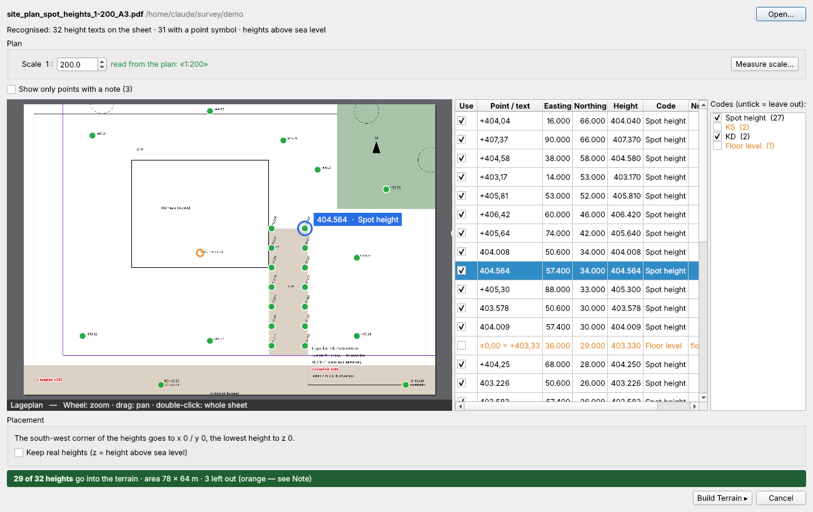

# Topology — Anleitung

Gelände aus Höhenlinien oder Punkten für IngeTrazo.
Version 1.2 · © 2026 Pesi (pesi3d.de) · GPL-3.0-or-later

---

## 1. Installation

1. In IngeTrazo: **Extensions ▸ Open extensions folder** (Windows: `%APPDATA%\ingetrazo\plugins\`).
2. `topology_tool_1.2.zip` dort entpacken, sodass der Ordner **`topology_tool`** direkt im Plugins-Ordner liegt (darin `__init__.py`). Über **Extensions ▸ Manage extensions…** installiert, passiert das von selbst.
3. Eine ältere **`topology_tool.py`** aus dem Plugins-Ordner löschen (Topology 1.0 / 1.1 war eine einzelne Datei).
4. IngeTrazo neu starten. Die Version steht in den Dialogtiteln (`Topology 1.2 — …`).

Menü: **Extensions ▸ Topology ▸** *Terrain from Contours… · Terrain from Points… · Terrain from Plan… · Edit Terrain…* — dazu die Werkzeugleiste **Topology** (je ein Icon). Höhenlinien und Punkte auch im Rechtsklick-Menü.

---

## 2. Gelände aus Höhenlinien (Terrain from Contours)

1. Höhenlinien auswählen (lose Kanten oder eine Gruppe, z. B. ein DWG-Import).
2. Rechtsklick ▸ **Topology ▸ Terrain from Contours…**
3. Einstellungen wählen, **Preview** einschalten, dann **OK**.

| Feld | Bedeutung |
|---|---|
| **Cells on long side / Cell size** | Auflösung des Rasters. 300–500 Zellen reichen meist. |
| **Footprint** | *Outline* = endet, wo die Daten enden · *Rectangle — interpolated* = bis zum umschließenden Rechteck ergänzt · *Rectangle — cut* = größtes Rechteck innerhalb der Daten |
| **Summits & pits** | *Rounded* = Kuppe/Mulde innerhalb der höchsten/tiefsten geschlossenen Linie · *Flat* = flach |
| **Smooth surface (radius)** | *Off (raw)* = die Fläche läuft exakt durch jede Linie, mit leichtem Knick an jeder Linie. Ein Radius (2–5 m) verrundet die ganze Fläche ohne Knicke und zieht sie wieder an die Linien — wenige Zentimeter neben den Linien, aber ruhig und meist näher am echten Gelände. |
| **Faces: Quads instead of triangles** | Ein Viereck pro Rasterzelle statt zwei Dreiecken — halb so viele Flächen, identische Form. Praktisch für den Export nach 3ds Max, Blender usw. (nur Höhenlinien; Punkte ergeben immer Dreiecke). |
| **Soft edges** | Blendet die Dreieckskanten aus (ruhige Optik). |
| **Skirt, depth** | Senkrechte Seitenwände bis *tiefster Punkt − Tiefe*. |
| **Close the bottom** | Schließt den Boden → wasserdichter Körper. |
| **Include the contours / contour map** | Nimmt die Linien auf ihrer Höhe / flach am Sockel mit auf. |

### Clean up lines (nur Höhenlinien)

Für dichte, zackige oder zerstückelte Linien (DWG aus Scans, vektorisierte Pläne). Nicht-destruktiv: Die Originallinien bleiben erhalten, alles lässt sich über **Edit Terrain** wieder ändern. Der Viewport zeigt die bereinigten Linien.

| Feld | Wirkung |
|---|---|
| **Simplify (tolerance)** | Entfernt Punkte, die näher als dieser Wert an der Linie durch ihre Nachbarn liegen — weniger Punkte, gleiche Form. Start mit 0,1–0,5 m. |
| **Smooth** | 1–3 Durchgänge entfernen kleine Zacken und Treppen, ohne die Linien schrumpfen zu lassen. |
| **Ignore lines shorter than** | Kleinstfragmente (Textreste, Fehlstriche) werden automatisch ausgeschaltet; die Liste markiert sie mit *too short*. |

Die Zeile darunter zeigt das Ergebnis, z. B. *Vertices: 5,987 → 1,028 (83 % fewer) · 12 short lines ignored*.

**Sicherheitsgrenze:** Über 1.000.000 Dreiecken wird die Infozeile rot und OK gesperrt (jedes Dreieck braucht ca. 2 KB Arbeitsspeicher). **Build anyway — at my own risk** gibt es einmalig frei — vorher speichern.

---

## 3. Altitude Editor (Edit Contours)

Für Höhenlinien ohne Höhe (flaches 2D-DWG) oder mit falscher Höhe. Der Dialog bleibt offen, während du im Viewport arbeitest.

Öffnen mit **◂ Edit Contours** im Bereich **Source** (öffnet sich von selbst, wenn alle Linien flach sind).

### Farben im Viewport

| Farbe | Bedeutung |
|---|---|
| Blau | Linie hat ihre ursprüngliche Höhe |
| Grün | Höhe im Editor gesetzt |
| Orange (dick) | ausgewählt |
| Grau gestrichelt | ignoriert (wird nicht verwendet) |

### Linien auswählen

* Linie im Viewport anklicken (**Select**-Werkzeug) oder in der Liste.
* **Shift/Strg-Klick** in der Liste wählt einen Bereich oder mehrere Linien.
* **Entf** im Viewport ignoriert die angeklickte Linie.

### Ausgewählte Linien bearbeiten

| Button | Wirkung |
|---|---|
| **Set altitude** | Gibt allen ausgewählten Linien den Wert aus **Selected**. |
| **✓ Use selected lines** | Schaltet die Auswahl EIN — sie formt das Gelände. |
| **✗ Ignore selected lines** | Schaltet sie AUS — das Gelände entsteht ohne sie. |
| **Reset to original height** | Zurück auf die Höhe, die die Linie im Modell hatte (nicht 0 — außer sie lag auf 0). |

Doppelklick auf eine **Altitude**-Zelle → Einzelwert tippen. Der **On**-Haken in einer markierten Zeile wirkt auf alle markierten Zeilen.

### Number the lines — viele Höhen auf einmal

**Start** = Höhe der ersten Linie · **Interval** = Höhenlinien-Abstand (z. B. 2 m).

**Profile: click 2 points** — am schnellsten, je ein Hang

1. **Start** = unterste Linie (z. B. 402), **Interval** (z. B. 2).
2. Button klicken → „Click point 1 of 2“.
3. Im Viewport (am einfachsten in Draufsicht) **außerhalb der untersten Linie** klicken, dann **auf dem Gipfel**.
4. Alle Linien, die die gedachte Strecke kreuzt, werden der Reihe nach nummeriert: 402, 404, 406 …

* Mehrere Hügel → je Hügel ein Profil.
* Senke → vom Rand zum tiefsten Punkt klicken, **Interval negativ**.
* „The profile crossed no line.“ → die Strecke hat keine gezeichnete Linie berührt (Klicks zu nah beieinander oder ein Klick landete auf dem Dialog).

**Click lines in order** — volle Kontrolle, für komplizierte Formen

1. **Start** und **Interval** setzen, Button klicken.
2. Linien im Viewport nacheinander anklicken; jede bekommt den nächsten Wert („Next: …“ zeigt ihn).
3. Button erneut klicken zum Beenden.

| Methode | Vorteil | Wann |
|---|---|---|
| **Profile** | 2 Klicks für einen ganzen Hang | einfacher Hügel oder Hang |
| **Click in order** | du bestimmst die Reihenfolge | Täler, Kämme, mehrere Kuppen |
| **Set altitude / Liste** | exakte Einzelwerte | Korrekturen, Sonderhöhen |

**Tipp:** Bekommen flache Linien echte Höhen (z. B. 400 m), springen sie im Viewport nach oben — Zoom Extents oder orbiten.

---

## 4. Live Preview

**Preview** klicken → der Button wird grün (**● Live Preview ON**) und eine Statuszeile erscheint:

* grün **LIVE PREVIEW** — jede Änderung wirkt sofort,
* orange **Updating…** / **Preview paused** — mit Grund (z. B. alle Linien auf einer Höhe); läuft von selbst weiter,
* rot — die Vorschau ist fehlgeschlagen.

Grünen Button erneut klicken → Vorschau aus.

---

## 5. Gelände aus Punkten (Terrain from Points)

Hilfspunkte (Tape Measure), Vertices/Kanten oder — ohne Auswahl — die Vermessungspunkte des Dokuments wählen, dann **Terrain from Points…**

> **Punktlisten (CSV) vom Vermesser:** mit IngeTrazos eigenem Import einlesen — Bereich **Terrain** ▸ **Survey points** ▸ **Import CSV…** (UTM, Spalten Punkt, Hochwert, Rechtswert, Höhe, Beschreibung). Danach baut **Terrain from Points…** ohne Auswahl das Gelände genau aus diesen Punkten.

* Die Fläche geht exakt durch jeden Punkt (Delaunay-TIN).
* **Max. edge length on the rim** (nur bei *Outline*): schneidet lange Randdreiecke ab → eingebuchteter Umriss. Faustregel: 2–3 × der im Dialog angezeigte typische Punktabstand.
* **Footprint**, **Skirt**, **Close the bottom**, **Soft edges** wie oben.

---

## 6. Gelände aus einem Plan (Terrain from Plan — Höhenkoten aus PDF)

Viele Lage- und Vermessungspläne zeigen das Gelände als **Höhenkoten**: ein Punktsymbol mit einer Höhe daneben. **Terrain from Plan…** liest sie direkt aus dem PDF des Plans — es muss kein Punkt gezeichnet oder abgetippt werden.

### Was gelesen wird

| Im Plan | Beispiel | Fürs Gelände? |
|---|---|---|
| Höhenkote mit Symbol (geviertelter Kreis, Punkt, Kreuz …) | `+402,35` · `403.120` | **ja** — der Punkt ist das Symbol, nicht der Text |
| Kanaldeckel | `KD 400,95` | **ja** (liegt auf dem Gelände) |
| Kanal-/Schachtsohle | `KS 398,70` | nein — von Anfang an abgehakt |
| Fußbodenhöhe eines Gebäudes | `±0,00 = +403,33` | nein — von Anfang an abgehakt |
| Gefälle, Δh, Maße | `2,5%` · `Δh 0.70` · `28,00` | wird ignoriert |

Das PDF muss ein **Vektor-PDF** aus dem CAD sein (ArchiCAD, AutoCAD, Vectorworks …). Ein eingescannter Plan (nur Bild) kann nicht gelesen werden.

### Schritt für Schritt

1. **Extensions ▸ Topology ▸ Terrain from Plan…** (oder das Icon in der Werkzeugleiste **Topology**) und das PDF wählen. Bei mehrseitigen PDFs erscheint **Sheet** zur Blattauswahl.
2. **Maßstab prüfen.** **Scale 1 :** zeigt den aus dem Plan gelesenen Maßstab, grün: *read from the plan: «1:200»*. Orange heißt: nicht gefunden — eintippen oder **Measure scale…**:
   * zwei Punkte im Plan anklicken, deren echte Entfernung du kennst (der Klick rastet an Linienenden ein — Maßkette, Raster, Gebäudekante),
   * die echte Entfernung in Metern eingeben → der Maßstab wird berechnet, blau: *measured: 50.0 mm on paper = 10 m*.
3. **Punkte prüfen.** Links der Plan mit allen gefundenen Höhen — **grün** = verwendet, **orange** = weggelassen. Rechts die Tabelle mit **Point / text** (wie im Plan geschrieben), **Easting / Northing** (Meter im Plan), **Height**, **Code** und **Note**.
   * Klick auf einen Punkt im Plan → seine Zeile wird markiert; Zeile wählen → der Punkt bekommt einen blauen Ring mit seinem Text.
   * **Use**: einzelne Höhe an- oder abhaken.
   * **Codes**: eine ganze Art an- oder abhaken (z. B. *KS* anhaken, wenn Sohlen mit sollen, *KD* abhaken, um Deckel wegzulassen).
   * **Show only points with a note** zeigt nur die zweifelhaften. Hinweise: *no point symbol found — text position used* (die Höhe sitzt am Textanfang), *duplicate of row n* (dieselbe Höhe doppelt an einer Stelle), *floor level — not the ground*, *height far off*.
   * Mausrad = Zoom, Ziehen = Verschieben, Doppelklick = ganzes Blatt.
4. **Placement:** Die Südwest-Ecke der Höhen kommt auf x 0 / y 0, die tiefste Höhe auf z 0 — das Gelände liegt direkt im Nullpunkt. Mit **Keep real heights** bleibt z = Höhe über NN.
5. **Build Terrain ▸** öffnet *Terrain from Points* (Abschnitt 5) mit Live Preview: Footprint, Skirt, geschlossener Boden, weiche Kanten — dann **OK**. Das Gelände merkt sich den Plan; **Edit Terrain…** funktioniert wie gewohnt.

### Tipps

* Wenige Höhen ergeben ein grobes Gelände — stehen nur entlang der Zufahrt Höhen im Plan, entsteht nur dort Gelände. Wo vorhanden, mit Höhenlinien kombinieren.
* Den Maßstab jedes Mal prüfen: Ein falscher Maßstab macht das Gelände zu groß oder zu klein (die Höhen bleiben richtig).
* Sitzt eine Höhe an der falschen Stelle, abhaken — wirken *alle* Positionen verzerrt, den Maßstab neu messen.

---

## 7. Gelände bearbeiten (Edit Terrain)

Mit diesem Plugin erzeugtes Gelände wählen ▸ Rechtsklick ▸ **Edit Terrain…** — Quelle, Höhen, Ein/Aus-Zustände und alle Einstellungen kommen zurück; OK baut es an derselben Stelle neu (ein Undo-Schritt).

---

## 8. Beispieldateien

Im Ordner `examples/` liegen vier Szenen zum Ausprobieren (**File ▸ Open**) — alle beginnen im Nullpunkt (0, 0, 0) und sind etwa 200 × 150 m groß — und ein Plan für **Terrain from Plan…**.

| Datei | Inhalt | Ausprobieren |
|---|---|---|
| `contours.igz` | Gruppe *Contours*: saubere Höhenlinien, Höhen 0–34 m | **Terrain from Contours…** mit den Standardeinstellungen |
| `contours_flat.igz` | Gruppe *Contours_Flat*: dieselben Linien, alle auf Höhe 0 (wie ein flaches 2D-DWG) | **Altitude Editor** — mit *Number the lines* Höhen vergeben |
| `contours_messy.igz` | Gruppe *Contours_Messy*: Zickzack-Linien und kleine Fehlstücke | **Clean up lines** — Simplify, Smooth, Ignore lines shorter than |
| `point_cloud.igz` | 860 Vermessungspunkte (Hilfspunkte) | **Terrain from Points…** — Footprint, Max. edge length on the rim |
| `site_plan_spot_heights_1-200_A3.pdf` | Erfundener Lageplan 1:200 mit 27 Höhenkoten (geviertelte Kreise und rote Messpunkte), Schächten (KD/KS) und einer Fußbodenhöhe | **Terrain from Plan…** — der Maßstab wird aus dem Plankopf gelesen |
